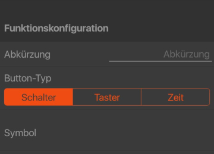

# DCC-A

Dieses Repository enthält eine Beschreibung aktueller Probleme der folgenden [RailCommunity](https://www.railcommunity.org) Normen
- [RCN-218 DCC-Protokoll DCC-A - Automatische Anmeldung](https://normen.railcommunity.de/RCN-218.pdf)
- [TN-218 - DCC-Protokoll Bild- und Icon-Nummern für DCC-A](https://normen.railcommunity.de/TN-218.pdf)

Wir erörtern die Probleme an Hand der aktuellen Norm und einiger Beispiele, vergleichen anschließend wie diese innerhalb des MFX-Protokolls gelöst wurden und machen auf Basis dessen Vorschläge zur Änderung der Norm.

  
Inhaltsverzeichnis

  <ol>
    <li><a href="#probleme">Probleme</a></li>
      <ul>
        <li><a href="#rcn-218-datenraum-2-shortgui">RCN-218 Datenraum 2 ShortGUI</a></li>
        <li><a href="#rcn-218-datenraum-4-icon-zuordnung">RCN-218 Datenraum 4 Icon Zuordnung</a></li>
        <li><a href="#tn-218-nummern-der-fahrzeugbilder-und-funktions-icons">TN-218 Nummern der Fahrzeugbilder und Funktions-Icons</a></li>
      </ul>
    <li><a href="#vergleich-mit-mfx">Vergleich mit MFX</a></li>
    <li><a href="#änderungsvorschlag-rcn-218">Änderungsvorschlag RCN-218</a></li>
      <ul>
        <li><a href="#datenraum-2-shortgui">Datenraum 2 ShortGUI</a></li>
      </ul>
    <li><a href="#änderungsvorschlag-tn-218">Änderungsvorschlag TN-218</a></li>
      <ul>
        <li><a href="#nummern-der-fahrzeugbilder">Nummern der Fahrzeugbilder</a></li>
        <li><a href="#nummern-der-funktions-icons">Nummern der Funktions-Icons</a></li>
      </ul>
  </ol>

## Probleme
An jener Stelle sei kurz die Einleitung der RCN-218 zitiert, die das allgemeine Ziel von DCC-A formuliert.

> Diese Norm beschreibt DCC-A, ein automatisches Anmeldeverfahren für DCC. Damit wird die Anwenderfreundlichkeit von Modellbahnsteuerungen signifikant erhöht. Bei Anwendung dieser Norm wird der Benutzer bei der Vergabe von Adressen und Zuweisung von Funktionen entlastet. Ziel ist es, z.B. ein Fahrzeug nach dem Aufgleisen sofort mit Namen und allen Eigenschaften im Fahrpult verfügbar zu haben.

Die Eigenschaften die hier erwähnt werden und direkt für den Nutzer sichtbar sind werden in den sogenannten Datenräumen hinterlegt. Als problematisch erachten wir
- Datenraum 2 ShortGUI sowie
- Datenraum 4 Icon Zuordnung

### RCN-218 Datenraum 2 ShortGUI
Der Datenraum 2 ShortGUI ist aktuell wie folgt definiert:
| Byte  | Bedeutung                                                                                                                                                                     |
| ----- | ----------------------------------------------------------------------------------------------------------------------------------------------------------------------------- |
| 0-7   | Benutzerdefinierter Name des Decoders, utf8 kodiert. Wenn weniger als 8 Byte verwendet werden, ist der Rest mit 0 aufzufüllen.                                                |
| 8     | 16 Bit Nummer des Fahrzeugbildes (MSB) entsprechend [TN-218](https://normen.railcommunity.de/TN-218.pdf)                                                                      |
| 9     | 16 Bit Nummer des Fahrzeugbildes (LSB) entsprechend [TN-218](https://normen.railcommunity.de/TN-218.pdf)                                                                      |
| 10    | Bits 7...6 Funktionsauskunft F0 Bit 5 reserviert Bit 4 Daten unvollständig (z.B. weil noch Daten aus einem SUSI-Modul fehlen) Bits 3...0 vereinfachtes Prinzipsymbol |
| 13... | Funktionsauskunft F1...Fx je zwei Bit pro Funktion, diese geben Auskunft, ob die Funktion benutzbar ist und ob diese schaltend oder tastend verwendet wird.                   |

Die Funktionsauskunft ist folgendermaßen codiert:
| Bit 1, Bit 0 | Bedeutung                                                                                                                                 |
| ------------ | ----------------------------------------------------------------------------------------------------------------------------------------- |
| 00           | Funktion ist nicht vorhanden                                                                                                              |
| 01           | Funktion ist vorhanden und schaltend benutzbar (z.B. Licht)                                                                               |
| 10           | Funktion ist vorhanden und tastend benutzbar                                                                                              |
| 11           | Funktion ist vorhanden und sowohl schaltend als auch tastend benutzbar, z.B. weil im Decoder und einem SUSI-Modul unterschiedlich genutzt |

Wir identifizieren hier folgende Probleme:
1. Die Nummer des Fahrzeugbildes entsprechend [TN-218](https://normen.railcommunity.de/TN-218.pdf) besitzt ~~keine~~ **kaum eine Hierarchie**. Was dies in der Praxis bedeutet werden wird in Kapitel [TN-218 Nummern der Fahrzeugbilder und Funktions-Icons](#tn-218-nummern-der-fahrzeugbilder-und-funktions-icons) erörtern.
2. Analogfunktionen und Binärzustände werden **nicht berücksichtigt**, obwohl diese bereits von einigen Herstellern verwendet werden.
3. Die Funktionsauskunft ist mit lediglich zwei Bit pro Funktion **zu knapp bemessen**. Als Beispiel sei hier die [Z21 App](https://www.z21.eu/de/produkte/z21-app) angeführt, deren *Funktionsauskunft* sich bereits nicht mehr darstellen ließe. 
 

### RCN-218 Datenraum 4 Icon Zuordnung
Der Datenraum 4 Icon Zuordnung ist aktuell wie folgt definiert:
| Maximale Anzahl Bytes | Bedeutung                                                                                                                    |
| --------------------- | ---------------------------------------------------------------------------------------------------------------------------- |
| 1                     | Funktionsnummer                                                                                                              |
| 2                     | Nummer des zuzuordnenden Icons Die Tabelle der Icon-Nummern steht in [TN-218](https://normen.railcommunity.de/TN-218.pdf) |
| 1                     | Funktionsnummer                                                                                                              |
| 2                     | ...                                                                                                                          |

Wir identifizieren hier folgende Probleme:
1. Die Nummer des Funktions-Icons entsprechend [TN-218](https://normen.railcommunity.de/TN-218.pdf) besitzt **keine Hierarchie**. Was dies in der Praxis bedeutet werden wird in Kapitel [TN-218 Nummern der Fahrzeugbilder und Funktions-Icons](#tn-218-nummern-der-fahrzeugbilder-und-funktions-icons) erörtern.
2. Analogfunktionen und Binärzustände werden **nicht berücksichtigt**, obwohl diese bereits von einigen Herstellern verwendet werden.

### TN-218 Nummern der Fahrzeugbilder und Funktions-Icons
Wir haben nun bereits an zwei Stellen auf eine fehlende Hierarchie hingewiesen, einmal bei den Fahrzeugbildern und einmal bei den Funktions-Icons.

### Fahrzeugbilder
Bei den Fahrzeugbildern ist aktuell ein fortlaufender 16 Bit Wert in Kombination mit einem 4 Bit Prinzipsymbol vorgesehen. Für manche Fahrzeugtypen gibt es gleich eine ganze Reihe aufeinanderfolgender Nummern (z.B. fünf Einträge für eine `Class 66/77`), für manche Fahrzeugtypen gibt es lediglich einen Eintrag (z.B. `V200`). Das Problem ist, dass es zwischen den Einträgen keinerlei Relation gibt. Hat ein Hersteller also beispielsweise ein Bild einer `Class 66/77`, aber **nicht exakt** jenes in der richtigen Farbe oder vom richtigen Betreiber, dann bleibt als einzige Möglichkeit lediglich das Prinzipsymbol `Diesellok` anzuzeigen.

### Funktions-Icons
Bei den Funktions-Icons ist aktuell ein fortlaufender 8-24 Bit Wert vorgesehen. Eine Sortierung wurde per Kommentar bewusst nicht vorgenommen:
> Diese Liste ist bewusst unsortiert, da jede Sortierung nicht von Dauer ist, wenn die Liste erweitert wird.

Eine Rückfallebene wie etwa das Prinzipsymbol wurde hier **überhaupt nicht** vorgesehen. Hat ein Hersteller ein Icon nicht, so kann **gar nichts** mehr angezeigt werden außer ein generisches `F` Symbol.

## Vergleich mit MFX
Es folgt ein kurzer Exkurs in das MFX-Protokoll.

### Fahrzeugbilder
Märklin vergibt eine 32 Bit Produktnummer an Hand derer dem angemeldeten Decoder ein Fahrzeugbild aus der Zentrale zugeordnet wird. Methoden für Fremdhersteller existieren nur in der Theorie. Die Märklin-eigene Methode unterscheidet sich somit nicht unwesentlich von jener der TN-218, mit dem entscheidenden Unterschied dass **Märklin die alleinige Kontrolle** besitzt. Die Ausgangslage ist somit eine gänzlich andere. Technisch ließe sich eine herstellerübergreifende Datenbank leicht umsetzen, wir denken jedoch nicht dass dies im Interesse der assoziierten Mitglieder der RailCommunity ist. In der Praxis wird man mit dem Fahrzeugbild eines anderen Herstellers ohnehin wenig anfangen können.

### Funktions-Icons
Märklin stellt Funktions-Icons durch 1-3 Byte dar. Hierbei enthält das
- 1.Byte die Kategorie
- 2.Byte das Grundsymbol
- 3.Byte einen "Modifikator"

Dies erlaubt Märklin zwei Rückfallebenen zu nutzen. Die Mobile Station unterstützt lediglich das 1.Byte, wohingegen die Central Station auch das 2. und 3.Byte liest.

Ein Beispiel, es soll ein Icon für `Kranarm senken` (siehe TN-218 S.11) angezeigt werden. Im MFX-Protokoll könnte man hier
- die Kategorie `Kran`,
- das Grundsymbol `Kranarm`,
- und den Modifikator `senken`
wählen.

Je nachdem ob ein Hersteller nun ein Icon für `Kranarm senken`, nur eines für `Kranarm` oder gar nur eines für `Kran` hat kann seitens der Zentrale das bestmögliche Icon gewählt werden. Selbst im simpelsten Fall sieht der Kunde zumindest noch einen Kran statt einem `F`.

> [!NOTE]  
> Dieses Beispiel ist konstruiert und dient nur zur Veranschaulichung.

## Änderungsvorschlag RCN-218
Um die oben genannten Probleme zu lösen schlagen wir folgende Änderungen an den Datenräumen 2 (ShortGUI) und 4 (Icon Zuordnung) vor.

### Datenraum 2 ShortGUI
| Byte  | Bedeutung                                                                                                                      |
| ----- | ------------------------------------------------------------------------------------------------------------------------------ |
| 0-7   | Benutzerdefinierter Name des Decoders, utf8 kodiert. Wenn weniger als 8 Byte verwendet werden, ist der Rest mit 0 aufzufüllen. |
| 8-10  | Bits 23...19 Grundbauarten Bits 18...6 Baureihe Bits 5...0 Lackierung                                                    |
| 11    | Bits 7...5 reserviert Bit 4 Daten unvollständig (z.B. weil noch Daten aus einem SUSI-Modul fehlen) Bits 3...0 reserviert |
| 12... | [Steuerungsauskunft](#steuerungsauskunft)                                                                                      |

Die 16 Bit Nummer des Fahrzeugbildes wird auf 24 Bit erhöht. Statt einer fortlaufenden Nummer werden in diesen 24 Bits die
- Grundbauart (vormals Prinzipsymbol)
- Baureihe und
- Lackierung
des Fahrzeugs codiert. Dies erlaubt es einer Zentrale die korrekte Baureihe anzuzeigen, auch wenn für die exakte Lackierung kein Fahrzeugbild zur Verfügung steht.

Die 2 Bit Funktionsauskunft pro Funktion werden auf 2-4 Bytes [Steuerungsauskunft](#steuerungsauskunft) erhöht. Dies erlaubt es sowohl Analogfunktionen als auch Binärzustände einzubinden.

#### Steuerungsauskunft
Jede Steuerungsauskunft besteht aus 2-4 Bytes und ist folgendermaßen codiert:
| Byte | Bedeutung | bei Funktionsnummer                       | bei Analogfunktion | bei Binärzustand                          |
| ---- | --------- | ----------------------------------------- | ------------------ | ----------------------------------------- |
| n    |           | 0-68 Funktionsnummer                      | ==254              | ==255                                     |
| n+1  |           | [Funktionsverhalten](#funktionsverhalten) | Analogkanal        | Binärzustandsadresse LSB                  |
| n+2  |           |                                           | Minimalwert        | Binärzustandsadresse MSB                  |
| n+3  |           |                                           | Maximalwert        | [Funktionsverhalten](#funktionsverhalten) |

Funktionen und Binärzustände geben ihr [Funktionsverhalten](#funktionsverhalten) bekannt, wohingegen Analogfunktionen einen Minimal- und Maximalwert enthalten.

#### Funktionsverhalten
Das Funktionsverhalten ist folgendermaßen codiert DDDD-VVVV:
| VVVV   | Bedeutung                                                                                            |
| ------ | ---------------------------------------------------------------------------------------------------- |
| 0      | reserviert                                                                                           |
| 1      | Schalter                                                                                             |
| 2      | Taster                                                                                               |
| 3      | Schalter & Taster (z.B. weil im Decoder und einem SUSI-Modul unterschiedlich genutzt)                |
| 4      | Einschalter, automatisches Ausschalten nach Zeit [Funktionsparameter DDDD](#funktionsparameter-dddd) |
| 5      | Ausschalter, automatisches Einschalten nach Zeit [Funktionsparameter DDDD](#funktionsparameter-dddd) |
| 6...15 | reserviert                                                                                           |

##### Funktionsparameter DDDD
| DDDD | Bedeutung | bei automatischem Aus- oder Einschalten nach Zeit |
| ---- | --------- | ------------------------------------------------- |
| 0    |           | 0.5s                                              |
| 1    |           | 1s                                                |
| 2    |           | 2s                                                |
| 3    |           | 4s                                                |
| 4    |           | 6s                                                |
| 5    |           | 8s                                                |
| 6    |           | 13s                                               |
| 7    |           | 20s                                               |
| 8    |           | 30s                                               |
| 9    |           | 46s                                               |
| 10   |           | 71s                                               |
| 11   |           | 109s                                              |
| 12   |           | 167s                                              |
| 13   |           | 256s                                              |
| 14   |           | 392s                                              |
| 15   |           | 600s                                              |

### Datenraum 4 Icon Zuordnung
| Maximale Anzahl Bytes | Bedeutung                                 |
| --------------------- | ----------------------------------------- |
| 3                     | [Steuerungsnummer](#steuerungsnummer)     |
| 3                     | Kategorie + [Grundsymbol + [Modifikator]] |
| 3                     | [Steuerungsnummer](#steuerungsnummer)     |
| 3                     | ...                                       |

Das 1 Byte Funktionsnummer wird auf 3 Byte [Steuerungsnummer](#steuerungsnummer) erhöht. Dies erlaubt es sowohl für Analogfunktionen als auch für Binärzustände ein Icon zuzuordnen.
Auf die Steuerungsnummer folgen bis zu 3 Bytes Icon Daten. Für die Codierung sei an dieser Stelle auf das Kapitel [Nummern der Funktions-Icons](#nummern-der-funktions-icons) verwiesen.

#### Steuerungsnummer
Jede Steuerungsnummer besteht aus 1-3 Bytes und ist folgendermaßen codiert:
| Byte | Bedeutung | bei Funktionsnummer  | bei Analogfunktion | bei Binärzustand         |
| ---- | --------- | -------------------- | ------------------ | ------------------------ |
| n    |           | 0-68 Funktionsnummer | ==254              | ==255                    |
| n+1  |           |                      | Analogkanal        | Binärzustandsadresse LSB |
| n+2  |           |                      |                    | Binärzustandsadresse MSB |

> [!NOTE]  
> Die Codierung der [Steuerungsnummer](#steuerungsnummer) ist ident mit den ersten Bytes der [Steuerungsauskunft](#steuerungsauskunft).

## Änderungsvorschlag TN-218
### Nummern der Fahrzeugbilder
TODO

### Nummern der Funktions-Icons
TODO

Dynamische Länge bei Icons?
Letztes Byte bei Icons Modifikator in 4x2er Nibble
XX XX XX XX

### TODO
Epoche?
Antriebsart?
Tacho-Daten?

## Kategorien
Außenbeleuchtung
Innenbeleuchtung
  Spitzen- und Schlusslicht
  Fern- und Abblendlicht
  Signal- und Warnlicht
  Sonderbeleuchtung(?)
  Anzeige-und Kennzeichnungslicht
  Fahrzeugbeleuchtung (allgemein)

Pantograph

Türe

Funktion(?)
Piktogramm(?)

Horn

Pfiff

Ansage

Straßenfahrzeug

Kran

Bremse

Schaltwerk

Rangieren

Kupplung

allgemein Geräuscht? Wohin z.B. mit Pufferstoß?